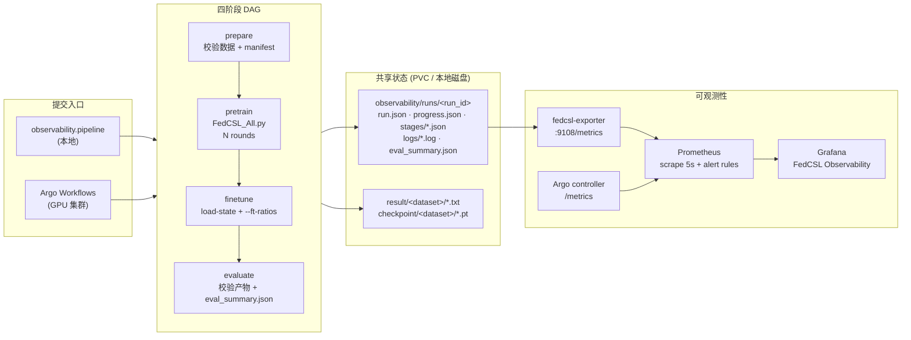

# FedCSL 可观测性设计：Argo Workflows + Prometheus + Grafana

> 状态：设计 + 本地闭环已验证；Kubernetes/Argo 清单已提供，本机未部署 GPU Kubernetes 集群。
> 分支：`feat/observability-argo-prom-grafana`（基于 `feat/muti-routine`）
> 日期：2026-10-27

## 1. 背景与目标

FedCSL 目前是“单进程脚本 + 文本日志”的实验模式：

- 预训练、逐轮评估、下游微调都在 `FedCSL_All.py` 一个进程内完成；
- 指标只写入 `result/<dataset>/*.txt` 和 stdout，没有结构化指标流；
- `run_tasks.py` / `dashboard/` 只能在本机以 PID 和日志文件管理任务；
- 没有工作流编排、失败重试、阶段门禁，也没有统一的 run 视图。

本设计引入 **Argo Workflows + Prometheus + Grafana**，目标：

1. 把实验拆成可重试、可观测的四阶段 DAG：**数据准备 → 预训练 → 下游微调 → 评估**；
2. 每个阶段有明确的输入/输出、退出码和产物路径，阶段之间用 checkpoint 交接；
3. 训练过程输出结构化进度（每轮 acc/loss/耗时），由 exporter 暴露为 Prometheus 指标；
4. Grafana 提供 run 维度、轮次维度、微调标签效率、GPU 资源和告警视图；
5. 在无 Kubernetes 的 Windows 工作站上也能用同一套阶段命令跑通闭环，便于研究和 CI 前移。

非目标：

- 不在本设计中修改联邦算法本身；
- 不替代论文实验的完整 hyper-parameter sweep；
- 暂不引入 MLflow/W&B（指标模型已为其预留 JSON 产物）。

## 2. 现状与约束

| 项 | 现状 | 对本设计的影响 |
|---|---|---|
| 训练入口 | `FedCSL_All.py` 单进程，`--ft-ratios` 在训练末尾执行微调 | 新增 `--save-final-checkpoint`、`--load-state`、`--final-checkpoint-path` 以支持阶段拆分 |
| 数据 | Epilepsy-TSTCC / LSST 已就绪；HAR 原始数据缺失 | 闭环默认 Epilepsy-TSTCC；HAR prepare 阶段支持 `process_har.py` |
| 指标 | 仅 `result/*.txt` + stdout | 新增 `observability/progress.py` 写出 `progress.json` |
| 本机 | Windows 11 + Docker Desktop 27 + RTX 4060 8GB；Docker Desktop Kubernetes 未启用；无 kind/argo | 本地用 `observability.pipeline` 执行同一 DAG；K8s 清单面向 GPU 集群 |
| 网络 | Docker Hub 直连不可用，DaoCloud 镜像可用；quay 可达 | 本地镜像走 `docker.m.daocloud.io`；Argo 镜像来自 quay |
| 路径 | 仓库路径含中文和空格 | 容器内固定使用 `/opt/fedcsl`（代码）与 `/data`（状态），避免路径问题 |
| 运行状态 | `result/` 文件名小时级，可能追加/覆盖 | 每个 run 使用唯一 description（`<run_id>_pretrain` / `_finetune`） |

## 3. 总体架构



设计原则：

- **阶段命令可移植**：每个阶段都是普通 CLI，本地与 Argo 用同一条命令，区别只在调度器；
- **状态落盘而非进程内**：阶段间只通过 checkpoint 和 JSON 产物交接，pod 可被重试/替换；
- **遥测与训练解耦**：训练只写本地 JSON（失败不影响训练），exporter 只读文件，Prometheus/Grafana 不侵入训练；
- **评估即门禁**：evaluate 阶段失败会让 Argo step 失败，避免“训练完成但产物缺失”被误判成功。

## 4. 流水线分阶段设计

### 4.1 prepare（数据准备/校验）

命令：

```bash
python -m observability.prepare --dataset Epilepsy-TSTCC --run-dir <run_dir>
```

职责：

- Epilepsy-TSTCC：校验 `Epilepsy/{train,val,test}.pt`，记录 shape、dtype、类别分布、SHA256；
- LSST：校验 `Multivariate_ts/LSST/LSST_{TRAIN,TEST}.ts`，解析 `@classLabel` 和行数；
- HAR：若 `HAR/{train,val,test}.pt` 缺失且 `UCI HAR Dataset/` 存在，执行 `python process_har.py`；否则失败并给出明确提示；
- 输出 `<run_dir>/dataset.json`（`status: passed|failed`）。

### 4.2 pretrain（预训练）

命令（核心）：

```bash
python -u FedCSL_All.py \
  -dataset Epilepsy-TSTCC \
  --config config/configACF.yml \
  --num-client 3 --num-rounds 2 --dirichlet-alpha 0.1 \
  --server-gpu 0 --client-gpus 0 --client-workers 1 \
  --eval-protocol svm --eval-every-n-rounds 1 --seed 42 \
  --description <run_id>_pretrain \
  --save-final-checkpoint \
  --final-checkpoint-path /data/checkpoint/<run_id>/final_round.pt
```

新增能力：

- `--save-final-checkpoint`：即使不启用微调，也在训练结束后落盘最终轮全局模型；
- `--final-checkpoint-path`：固定 checkpoint 路径，供下一阶段和 Argo 产物定位；
- 每轮结束写入 `observability/runs/<run_id>/progress.json`（round、train/test acc、loss、阶段耗时）。

产物：

- `result/<dataset>/*<run_id>_pretrain*.txt`
- `checkpoint/<dataset>/<run_id>/final_round.pt`（显式路径）
- `<run_dir>/progress.json` + `progress.jsonl`

### 4.3 finetune（下游微调）

命令（核心）：

```bash
python -u FedCSL_All.py \
  -dataset Epilepsy-TSTCC \
  --config config/configACF.yml \
  --num-client 3 --num-rounds 0 --dirichlet-alpha 0.1 \
  --server-gpu 0 --client-gpus 0 --client-workers 1 \
  --load-state /data/checkpoint/<run_id>/final_round.pt \
  --ft-ratios 0.1,1.0 --ft-seeds 1 \
  --description <run_id>_finetune
```

关键点：

- `--num-rounds 0` 跳过联邦训练循环；
- `--load-state` 在 Server/Client 构造后加载 state_dict，复用 `server.transform()` 做冻结表征；
- 现有 `_finetune_subset_eval` 逻辑不变，微调块写入 finetune 的 result 文件；
- 写出 `<run_dir>/progress_finetune.json`（`ft_results`）。

这是对原实现的**行为拆分**：原先是“训练最后一轮后立刻微调”，现在可以在不重跑预训练的情况下独立重试微调。

### 4.4 evaluate（评估门禁）

命令：

```bash
python -m observability.evaluate \
  --run-dir <run_dir> \
  --dataset Epilepsy-TSTCC \
  --pretrain-desc <run_id>_pretrain \
  --finetune-desc <run_id>_finetune \
  --expect-ft \
  --final-ckpt /data/checkpoint/<run_id>/final_round.pt
```

校验项：

1. pretrain 结果文件存在，至少解析出 1 轮 `server aggregation` 指标；
2. 存在有限 test accuracy；
3. finetune 结果文件存在，包含 `downstream fine-tuning ablation` 块；
4. 至少解析出一个 label ratio；
5. 微调块无异常标记（`微调消融失败` / traceback）；
6. final checkpoint 存在且非空。

输出 `<run_dir>/eval_summary.json`，并把结果指标提供给 exporter。失败返回退出码 2，Argo 将 step 标记为失败。

### 4.5 阶段契约

| 阶段 | 输入 | 输出 | 资源 | 失败影响 |
|---|---|---|---|---|
| prepare | 数据集目录 | `dataset.json` | CPU | 阻止后续阶段 |
| pretrain | dataset manifest、config、shapelet weights | result log、final ckpt、progress | GPU ×1 | 阻止 finetune/evaluate |
| finetune | final ckpt、dataset、config | result log、`progress_finetune.json` | GPU ×1 | evaluate 失败 |
| evaluate | 两个 result log、final ckpt | `eval_summary.json` | CPU | 整个 run 失败 |

## 5. 遥测数据模型

### 5.1 Run 目录布局

```
observability/runs/<run_id>/
├── run.json                 # run 元数据 + 各阶段状态
├── dataset.json             # prepare 产物
├── progress.json            # 预训练最新轮次
├── progress.jsonl           # 预训练历史（append-only）
├── progress_finetune.json   # 微调结果
├── stages/
│   ├── prepare.json
│   ├── pretrain.json
│   ├── finetune.json
│   └── evaluate.json
├── logs/
│   ├── prepare.log
│   ├── pretrain.log
│   ├── finetune.log
│   └── evaluate.log
└── eval_summary.json
```

### 5.2 `progress.json` 字段

```json
{
  "run_id": "obs-20261027-202829-d518a7",
  "phase": "pretrain",
  "dataset": "Epilepsy-TSTCC",
  "algo": "fedcsl",
  "alpha": 0.1,
  "seed": 42,
  "round": 1,
  "num_rounds": 2,
  "train_acc": 0.9987,
  "test_acc": 0.9873,
  "best_acc": 0.9873,
  "best_round": 1,
  "avg_loss": 9.9,
  "loss_terms": {"total": 9.9, "scale": 7.8},
  "timings": {"train": 32.9, "distribution": 1.2, "agg": 0.03, "eval": 41.0, "total": 75.2},
  "eval_skipped": false,
  "updated_at": 1793104567.0,
  "updated_at_iso": "2026-10-27T20:36:07+08:00"
}
```

### 5.3 阶段状态

`stages/<phase>.json`：

```json
{
  "phase": "pretrain",
  "status": "success",
  "started_at": "...",
  "ended_at": "...",
  "duration_s": 163.4,
  "exit_code": 0,
  "command": ["..."]
}
```

`run.json` 汇总整体 `status` 和各阶段状态，供 exporter 和人工排障使用。

## 6. 指标目录

Exporter 同时暴露 run 维度、轮次维度、微调维度、GPU 维度指标。标签 `run_id` 用于关联；`dataset`、`phase`、`ratio`、`stage` 用于切片。

| 指标 | 类型 | 含义 |
|---|---|---|
| `fedcsl_run_info{run_id,dataset,status}` | gauge=1 | run 身份与整体状态 |
| `fedcsl_run_start_timestamp_seconds{run_id}` | gauge | 开始时间 |
| `fedcsl_run_end_timestamp_seconds{run_id}` | gauge | 结束时间 |
| `fedcsl_stage_status{run_id,phase}` | gauge | 1=success，0=failed |
| `fedcsl_stage_duration_seconds{run_id,phase}` | gauge | 阶段耗时 |
| `fedcsl_round_current{run_id,phase}` | gauge | 当前轮次 |
| `fedcsl_round_total{run_id,phase}` | gauge | 总轮次 |
| `fedcsl_round_test_accuracy{run_id,phase}` | gauge | 最近一轮 test acc（0–1） |
| `fedcsl_round_train_accuracy{run_id,phase}` | gauge | 最近一轮 train acc |
| `fedcsl_round_best_accuracy{run_id,phase}` | gauge | 历史最佳 test acc |
| `fedcsl_round_avg_loss{run_id,phase}` | gauge | 最近一轮平均 loss |
| `fedcsl_round_stage_seconds{run_id,phase,stage}` | gauge | train/distribution/agg/eval/total 耗时 |
| `fedcsl_round_last_timestamp_seconds{run_id,phase}` | gauge | 最近一轮进度时间戳 |
| `fedcsl_run_progress_age_seconds{run_id,phase}` | gauge | 进度新鲜度（用于卡死告警） |
| `fedcsl_finetune_test_accuracy{run_id,ratio,seed}` | gauge | 每个标签比例/采样种子的微调准确率 |
| `fedcsl_finetune_mean_accuracy{run_id,ratio}` | gauge | 微调平均准确率 |
| `fedcsl_finetune_std_accuracy{run_id,ratio}` | gauge | 微调标准差 |
| `fedcsl_eval_passed{run_id}` | gauge | 评估门禁是否通过 |
| `fedcsl_artifact_present{run_id,kind}` | gauge=1 | 产物存在性 |
| `fedcsl_gpu_memory_used_bytes{gpu}` / `_total_bytes` | gauge | GPU 显存 |
| `fedcsl_gpu_utilization_ratio{gpu}` | gauge | GPU 利用率 |
| `fedcsl_gpu_temperature_celsius{gpu}` | gauge | GPU 温度 |
| `fedcsl_exporter_up` / `fedcsl_exporter_scrape_timestamp_seconds` | gauge | exporter 自监控 |

采集方式：

- **本地**：exporter 在 host 上运行，Prometheus 容器通过 `host.docker.internal:9108` 抓取；
- **K8s**：exporter 作为 Deployment 挂载共享 PVC，Prometheus 通过 `fedcsl-exporter.argo.svc:9108` 抓取；同时抓取 Argo controller 的 `/metrics`。

## 7. Argo 设计

### 7.1 资源布局

- 代码镜像：`fedcsl-train:observe`，代码位于 `/opt/fedcsl`；
- 共享 PVC：`fedcsl-work`（`ReadWriteMany`），挂载到 `/data`，保存数据集、checkpoint、result、run 状态；
- `deploy/argo/entrypoint.sh` 在容器启动时把 `/opt/fedcsl/{Epilepsy,Multivariate_ts,HAR,checkpoint,result,data,observability/runs}` 软链到 `/data/...`，使训练代码的相对路径无需修改；
- Argo WorkflowTemplate 与 exporter 都位于 `argo` 命名空间（同一 PVC 可挂载）；Prometheus/Grafana 位于 `observability` 命名空间。

### 7.2 WorkflowTemplate 要点

`deploy/argo/workflowtemplate.yaml`：

- `entrypoint: pipeline`，4 个 sequential steps；
- 参数：`dataset`、`config`、`numRounds`、`numClients`、`dirichletAlpha`、`ftRatios`、`ftSeeds`、`image`、`pvcName`；
- prepare/evaluate：CPU；
- pretrain/finetune：`nvidia.com/gpu: 1`，requests/limits 示例 4–8 CPU、12–24Gi 内存；
- `retryStrategy.limit: 1`，`backoff.duration: 30s`；
- `activeDeadlineSeconds: 21600`（6h，可按数据集调整）；
- 所有阶段通过 `observability.stage` 包装，自动写 `stages/*.json` 与日志；
- `archiveLogs: true`（需集群配置 artifact repository，如 MinIO/S3）。

### 7.3 与现有 Jenkins/Feishu 的关系

- Jenkins 继续负责 dashboard 部署（现有链路见 `docs/jenkins_dashboard_cicd.md`）；
- Argo 负责实验工作流，不替代 Jenkins 的代码部署；
- 通知：可用 Argo `onExit` 模板调用 `docs/feishu_cicd_design.md` 中的飞书卡片 payload；本期未接入，避免引入未实现的 `notify_service`。

### 7.4 为什么不是“继续用 run_tasks.py”

`run_tasks.py` 是长期驻留的 GPU 轮询调度器，依赖 `nvidia-smi`、不能重连、没有阶段门禁。Argo 提供：

- 每个 step 一个 pod，失败可重试；
- GPU 资源由 K8s device plugin 分配；
- 工作流状态、日志、产物集中管理；
- 可自然扩展为 `withItems` 做 dataset × alpha × seed 的 fan-out。

## 8. Prometheus 设计

### 8.1 本地

`deploy/observability/docker-compose.yml`：

- Prometheus `:9090`，5s scrape；
- Grafana `:3000`，自动 provision 数据源和 dashboard；
- 告警规则 `deploy/observability/prometheus/alerts.yml`。

### 8.2 集群

`deploy/argo/observability-stack.yaml` + `deploy/observability/prometheus/prometheus-k8s.yml`：

- scrape `fedcsl-exporter.argo.svc.cluster.local:9108`；
- scrape `workflow-controller-metrics.argo.svc.cluster.local:9090`；
- 告警规则同本地。

### 8.3 告警

| 告警 | 条件 | 含义 |
|---|---|---|
| `FedCSLStageFailed` | `fedcsl_stage_status == 0` | 阶段失败 |
| `FedCSLEvalGateFailed` | `fedcsl_eval_passed == 0` | 评估门禁失败 |
| `FedCSLNoRoundProgress` | running 且 15min 无新轮次 | 训练卡死 |
| `FedCSLExporterDown` | `up{job="fedcsl-exporter"} == 0` | 遥测中断 |
| `FedCSLGPUHighMemory` | 显存 >90% 持续 5min | OOM 风险 |
| `FedCSLGPUHighTemperature` | 温度 >85℃ | 硬件风险 |

## 9. Grafana 设计

`deploy/observability/grafana/dashboards/fedcsl-overview.json`（uid `fedcsl-overview`）：

- **顶部 stat**：Running / Succeeded / Failed / Exporter / Evaluation gate / Last round age；
- **Runs 表**：`fedcsl_run_info`，展示 run_id、dataset、status；
- **训练曲线**：test acc、train acc、loss vs round；
- **阶段耗时**：每轮 train/distribution/agg/eval/total 时序 + 阶段总耗时条形图；
- **微调标签效率**：`fedcsl_finetune_mean_accuracy`，按 ratio 图例；
- **GPU**：显存 used/total、利用率；
- **Runbook 文本面板**：命令与产物路径。

## 10. 本地验证（闭环）

由于本机 Docker Desktop Kubernetes 未启用、且 kind 无法透传 RTX 4060，本期在 Windows 宿主上用 `observability.pipeline` 执行与 Argo 相同的四阶段命令；Prometheus/Grafana 用 Docker Compose 运行。

验证命令：

```bash
# 终端 1：exporter
E:/code_tools/miniconda3/envs/CSL/python.exe -m observability.exporter \
  --root observability/runs --port 9108

# 终端 2：四阶段闭环
E:/code_tools/miniconda3/envs/CSL/python.exe -m observability.pipeline \
  --dataset Epilepsy-TSTCC --config config/configACF.yml \
  --num-rounds 2 --num-client 3 --alpha 0.1 \
  --ft-ratios 0.1,1.0 --ft-seeds 1

# 终端 3：Prometheus + Grafana
cd deploy/observability && docker compose up -d
```

验证点：

1. prepare 生成 `dataset.json`（2 类、train/val/test shape、SHA256）；
2. pretrain 每轮写入 `progress.json`，exporter `/metrics` 出现 `fedcsl_round_test_accuracy`；
3. finetune 生成 `progress_finetune.json` 和微调 result 块；
4. evaluate 生成 `eval_summary.json`，`fedcsl_eval_passed=1`；
5. Prometheus targets 两个 job UP；Grafana 自动加载 `FedCSL Observability` dashboard。

> 实测结果见文末“附录 A”。

## 11. 部署步骤

> 本机运行中的服务地址、账号密码和验证结果见 `deploy/observability/ACCESS.md`。

### 11.1 本地（已验证）

```bash
cd deploy/observability
docker compose up -d
# 宿主机另开终端
python -m observability.exporter --root observability/runs --port 9108
```

镜像来自 DaoCloud 镜像站；若网络允许 Docker Hub，可设置 `FEDCSL_IMAGE_PREFIX=docker.io`。

### 11.2 GPU Kubernetes（目标形态）

1. 构建镜像：

```bash
docker build -f deploy/observability/Dockerfile.training -t fedcsl-train:observe .
# 推送到集群可访问的 registry
```

2. 准备数据 PVC（`fedcsl-work`，RWX）：

```bash
kubectl apply -f deploy/argo/pvc.yaml
# 把 Epilepsy/、Multivariate_ts/、algoutils/shapelet_weight_All.npy 等复制到 PVC 的 /data 下
```

3. 安装 Argo Workflows（示例）：

```bash
kubectl create namespace argo
kubectl apply -n argo -f https://github.com/argoproj/argo-workflows/releases/download/v3.6.5/install.yaml
```

4. 安装 exporter 与 observability stack：

```bash
kubectl apply -f deploy/argo/exporter.yaml
kubectl apply -f deploy/argo/argo-controller-metrics-service.yaml
kubectl apply -f deploy/argo/observability-stack.yaml
```

5. 创建 Grafana/Prometheus 配置 ConfigMap（详见 `deploy/argo/README.md`），然后提交 workflow：

```bash
kubectl -n argo create -f deploy/argo/workflowtemplate.yaml
argo submit -n argo --from workflowtemplate/fedcsl-pipeline \
  -p dataset=Epilepsy-TSTCC -p numRounds=2
```

## 12. 安全与限制

- **无认证**：exporter 与 Argo UI 默认无认证；生产环境应放在内网/VPN，并启用 Argo Server 的 auth mode。
- **指标基数**：`run_id` 是高基数标签，exporter 默认只保留 168h 内的 run；长期保留需做聚合或降采样。
- **PVC 布局**：WorkflowTemplate 假设 `/data` 已预置数据；镜像不包含数据集和 `.npy`（均在 `.gitignore` 中）。
- **GPU**：kind/Docker Desktop 无法透明透传 GPU；本设计只在真实 GPU K8s 节点上执行 GPU step。
- **微调失败语义**：`FedCSL_All.py` 的微调块捕获异常后仍退出 0；因此必须依赖 evaluate 门禁（本设计已实现）。
- **结果文件命名**：小时级 + description 可能导致同小时重跑追加；run_id 唯一，避免同一 run 内冲突；跨 run 建议清理旧文件或改用 run_id 目录（后续工作）。
- **Docker Hub**：本机需经 DaoCloud 镜像；集群节点也需能访问 mirror 或私有 registry。

## 13. 运维手册

### 13.1 查看一次 run

```bash
ls observability/runs/<run_id>/
cat observability/runs/<run_id>/stages/*.json
cat observability/runs/<run_id>/eval_summary.json
curl -s localhost:9108/api/runs | jq .
curl -s localhost:9108/metrics | grep fedcsl
```

### 13.2 常见故障

| 现象 | 排查 |
|---|---|
| prepare 失败 | 数据集路径/大小；HAR 是否下载；`dataset.json.error` |
| pretrain 失败 | `stages/pretrain.json`、`logs/pretrain.log`；GPU/显存；shapelet weights 是否存在 |
| finetune 失败 | `--load-state` 路径；state_dict 与 config/数据是否匹配 |
| evaluate 失败 | `eval_summary.json.checks`；result 描述是否唯一；微调块是否被异常捕获 |
| Grafana 无数据 | exporter `/metrics`、Prometheus targets、`fedcsl_run_info` 是否存在 |
| 指标基数过大 | 缩短 `FEDCSL_EXPORTER_MAX_AGE_HOURS`；清理旧 run |

### 13.3 重跑策略

- 只重跑微调：保留 pretrain 产物，修改 `--ft-ratios` 后单独执行 finetune 阶段；
- 只重跑评估：`python -m observability.evaluate ...`，不重新训练；
- 断点续训：现有 `checkpoint_every`/`RESUME_CKPT` 仍可用；Argo 重试时建议固定 run description 或使用 resume 机制（后续工作）。

## 14. 后续工作

1. 在真实 GPU K8s 上提交 WorkflowTemplate，验证 `archiveLogs` 与 artifact repository；
2. 接入 Argo Events（GitHub webhook）替代 Jenkins 轮询；
3. 实现飞书 `onExit` 通知（复用 `docs/feishu_cicd_design.md` 卡片 schema）；
4. 将 `progress.jsonl` 导入 Loki/Tempo，做日志-指标关联；
5. 支持 dataset × algo × alpha × seed 的 `withItems` fan-out 与结果聚合；
6. 在 result 文件名中加入 run_id 目录，彻底消除小时级追加问题。

## 附录 A：本地闭环实测

**环境**：Windows 11、RTX 4060 Laptop 8GB、`E:\code_tools\miniconda3\envs\CSL`（Python 3.8.19 / torch 2.3.1 CUDA 12.1）、Docker Desktop 27.0.3。

**run_id**：`obs-20261027-202829-d518a7`

**命令**：

```bash
E:/code_tools/miniconda3/envs/CSL/python.exe -m observability.pipeline \
  --dataset Epilepsy-TSTCC --config config/configACF.yml \
  --num-rounds 2 --num-client 3 --alpha 0.1 \
  --ft-ratios 0.1,1.0 --ft-seeds 1
```

**结果**：

| 阶段 | 耗时 | 结果 |
|---|---:|---|
| prepare | 2.1s | Epilepsy-TSTCC 校验通过，2 类，train/val/test shape 已记录 |
| pretrain | 193.8s | 2 轮；round 0: test 0.9817 / train 0.9955；round 1: test 0.9826 / train 0.9957 |
| finetune | 33.1s | 10% 标签: 0.9622；100% 标签: 0.9743（1 个采样种子） |
| evaluate | 0.1s | 6 项检查全部 PASS（round 指标、FT 块、ratio、无异常、checkpoint） |

**产物**：

```
observability/runs/obs-20261027-202829-d518a7/
├── dataset.json 1720 B
├── progress.json / progress.jsonl
├── progress_finetune.json 862 B
├── eval_summary.json 3356 B
├── stages/{prepare,pretrain,finetune,evaluate}.json
└── logs/{prepare,pretrain,finetune,evaluate}.log
checkpoint/Epilepsy-TSTCC/obs-20261027-202829-d518a7_final_round.pt (603,052 B)
result/Epilepsy-TSTCC/*obs-20261027-202829-d518a7_{pretrain,finetune}*.txt
```

**Exporter 校验**（`http://127.0.0.1:9108/metrics`）：

```
fedcsl_run_info{dataset="Epilepsy-TSTCC",run_id="obs-20261027-202829-d518a7",status="succeeded"} 1
fedcsl_stage_status{phase="prepare"...} 1
fedcsl_stage_status{phase="pretrain"...} 1
fedcsl_stage_status{phase="finetune"...} 1
fedcsl_stage_status{phase="evaluate"...} 1
fedcsl_round_test_accuracy{phase="pretrain",...} 0.9826086956521739
fedcsl_finetune_mean_accuracy{ratio="0.1000",...} 0.9622
fedcsl_finetune_mean_accuracy{ratio="1.0000",...} 0.9743
fedcsl_eval_passed{run_id="obs-20261027-202829-d518a7"} 1
```

**Prometheus 校验**（`http://127.0.0.1:9090`）：

- Active targets:`fedcsl-exporter` **UP**、`prometheus` **UP**；
- 查询结果：
  - `fedcsl_run_info{run_id="obs-20261027-202829-d518a7",status="succeeded"} 1`
  - `fedcsl_round_test_accuracy{phase="pretrain"} 0.9826086956521739`
  - `fedcsl_finetune_mean_accuracy{ratio="0.1000"} 0.9622`
  - `fedcsl_finetune_mean_accuracy{ratio="1.0000"} 0.9743`
  - `fedcsl_eval_passed 1`
- 告警规则已加载：`FedCSLStageFailed`、`FedCSLEvalGateFailed`、`FedCSLExporterDown`、`FedCSLNoRoundProgress`、`FedCSLGPUHighMemory`、`FedCSLGPUHighTemperature`。

**Grafana 校验**（`http://127.0.0.1:3000`，admin/fedcsl）：

- 版本 10.4.5，`/api/health` 返回 `database: ok`；
- 数据源 `Prometheus` 健康检查返回 `"Successfully queried the Prometheus API."`；
- dashboard `FedCSL Observability` 已自动 provision，共 16 个 panel；
- 通过 Grafana 数据源代理查询 `fedcsl_run_info` 返回 `obs-...-d518a7 / succeeded / 1`。

**镜像/网络说明**：Docker Hub 直连不可用；通过系统代理（Clash `127.0.0.1:7892`）拉取官方镜像，Prometheus 271MB、Grafana 430MB。拉取过程中曾出现 `unexpected EOF` / `unauthorized` 重试，重启 Docker Desktop 并启用代理后恢复。镜像已按 compose 默认名称打 tag，`docker compose up -d` 可直接启动。

**Argo**：`deploy/argo/workflowtemplate.yaml` 及所有清单已做 YAML 解析校验；本机没有可用的 Kubernetes 集群（Docker Desktop Kubernetes 未启用，kind 无法透传 GPU），因此未实际提交 workflow。相同的阶段命令已通过 `observability.pipeline` 完整执行，Argo 版本只是把同一命令放进 pod 执行。

